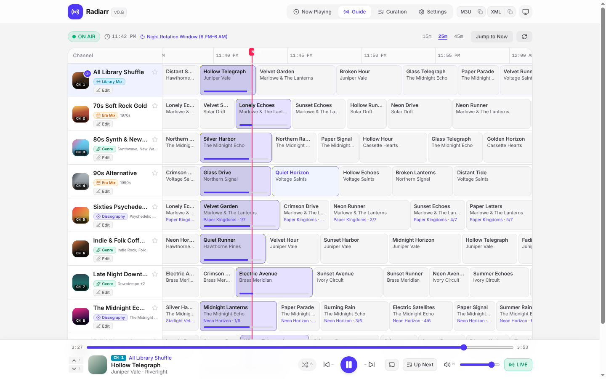
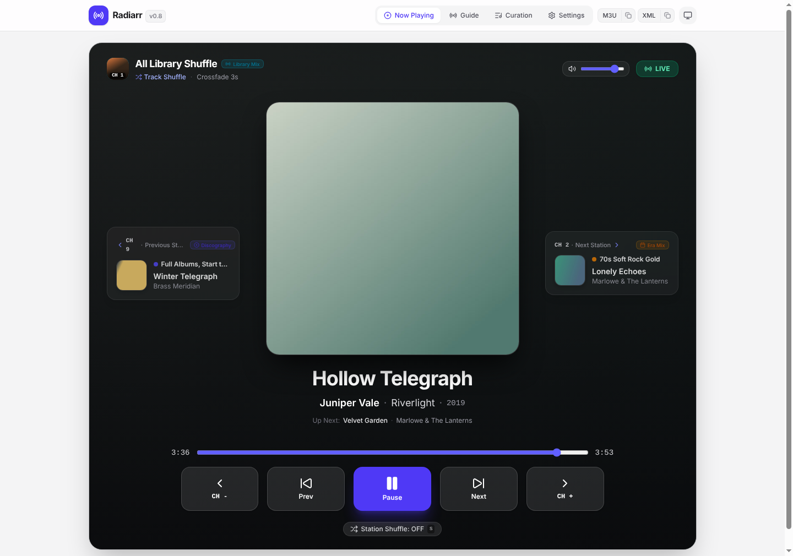
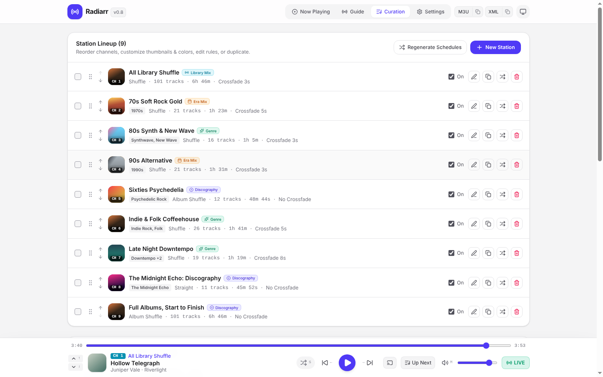
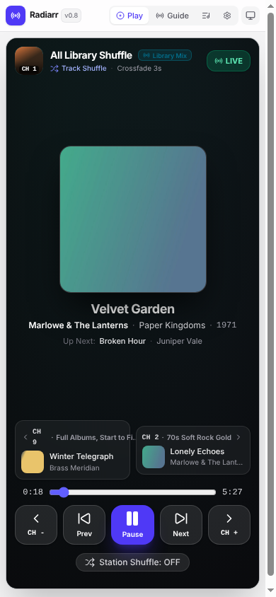

# Radiarr 📻

> **Your personal music library, turned into your dream radio dial.**
> Always-on virtual radio stations built from your **Plex** library, local folders, or NAS. Open it, and something good is already playing.

[](https://github.com/peanutismint/radiarr/releases)
[](#install)



## Contents

- [Why Radiarr?](#why-radiarr)
- [Features](#features)
- [Install](#install)
- [First run](#first-run)
- [Listening on your phone and in the car](#listening-on-your-phone-and-in-the-car)
- [Configuration](#configuration)
- [Security and remote access](#security-and-remote-access)
- [Roadmap](#roadmap)
- [Development](#development)

## Why Radiarr?

You spent years building a music collection. So why do you still end up:

1. Scrolling an endless artist list, unable to pick anything?
2. Playing the same comfort playlist for the 400th time?
3. Giving up and letting a streaming algorithm choose?

Radiarr is like [Tunarr](https://github.com/chrisbenincasa/tunarr), but for music. You describe the stations you want ("70s soft rock", "everything by Led Zeppelin in order", "chill in the morning, loud in the afternoon") and Radiarr keeps them on air forever. Tune in and you land mid-song, exactly where that station is on the clock. Don't like the song? Flip to the next station, the way you would in a car.

## Features

| | |
| :--- | :--- |
|  |  |
| **Now Playing**, with the neighbouring stations one click away | **Curation**, where you build and reorder your dial |

**📻 Stations that are always on.** Every station follows a fixed timeline worked out from the clock, not from a running process. Nothing plays, and no CPU is used, until you tune in. Open Radiarr on two devices and they play the same song at the same moment.

**🕹️ Simple rules, real variety.** Build a station from libraries, artists, albums, genres, or decades, then choose how it plays:

- **Track Shuffle** plays every matching song once before repeating any.
- **Album Shuffle** shuffles whole albums but plays each one start to finish.
- **Straight** plays a discography in release order.

**🕰️ Dayparting.** One station can change its rules through the day, for example acoustic at 6 AM, upbeat at noon, ambient after 10 PM.

**🎚️ Gapless playback and crossfades.** Albums play without gaps between tracks. Shuffle stations can crossfade (2, 3, 5, or 8 seconds) like real radio.

**🏎️ Steering wheel controls.** Over Bluetooth, your car's Next and Previous buttons switch stations like radio presets. Prefer them to skip tracks? Tap versus hold behaviour is configurable in Settings.

**⏪ Time-shifting.** Click any song in the guide, past or upcoming, to play it now. One click returns you to live.

**📺 Works with other players.** Radiarr publishes its stations as a standard M3U playlist with an XMLTV guide, so you can add them to Jellyfin, Plex Live TV, Kodi, TiviMate, or VLC.

**📦 Bulk station management.** Select several stations to drag, reorder, duplicate, reshuffle, enable, or delete them together.

**🧰 Diagnostics.** A built-in log shows playback events, transcodes, and connection tests, with a one-click export when something needs investigating.

## Install

There are two ways to run Radiarr. Both give you the same app.

| | Best for | You need |
| :--- | :--- | :--- |
| **Docker** | A home server or NAS that is always on | Docker |
| **Desktop app** | Trying it out, or running it on your everyday computer | Nothing else (see the FFmpeg note below) |

### Option 1: Docker

```bash
git clone https://github.com/peanutismint/radiarr.git
cd radiarr
```

Open `docker-compose.yml` and change `/path/to/your/music` to your music folder (you can skip this if you only use Plex). Then:

```bash
docker compose up -d --build
```

Open `http://localhost:8484`, or `http://<your-server-ip>:8484` from another device.

If your music is on a network share, see `docker-compose.nas-example.yml`.

### Option 2: Desktop app (Windows, macOS, Linux)

Download the installer for your system from [**Releases**](https://github.com/peanutismint/radiarr/releases):

| System | File to download |
| :--- | :--- |
| Windows 10 / 11 | The `Setup` `.exe` (or the portable `.exe` if you prefer not to install) |
| macOS, Apple Silicon (M1 or newer) | The `.dmg` with `arm64` in its name |
| macOS, Intel | The `.dmg` without `arm64` in its name |
| Linux | The `.AppImage`, or the `.deb` for Debian and Ubuntu |

Not sure which Mac you have? Open the Apple menu and choose **About This Mac**. "Chip: Apple M..." means Apple Silicon. "Processor: Intel" means Intel.

Closing the window keeps Radiarr running in the system tray, so other devices on your network can keep listening at `http://<your-computer-ip>:8484`. Quit from the tray icon to stop it.

#### Security warnings on first launch

The desktop app is not yet code-signed, so your computer will warn you the first time. This is expected.

**macOS** says the app "cannot be opened" or is from an unidentified developer:

1. Open **System Settings**, then **Privacy & Security**.
2. Scroll down to the message about Radiarr and click **Open Anyway**.
3. Confirm with your password or Touch ID. You only need to do this once.

If macOS says the app "is damaged", open Terminal and run:

```bash
xattr -cr /Applications/Radiarr.app
```

**Windows** shows a blue "Windows protected your PC" box:

1. Click **More info**.
2. Click **Run anyway**.

#### FFmpeg

Radiarr uses [FFmpeg](https://ffmpeg.org) to play formats that browsers cannot handle directly, such as FLAC, ALAC, and WMA. The Docker version includes it. The desktop app currently expects FFmpeg to be installed on your computer, so without it those formats will not play (MP3, AAC, and Plex libraries are unaffected). Bundling FFmpeg into the desktop installers is planned.

## First run

1. **Add your music.** Go to **Settings**, then **Libraries**. Sign in with Plex and pick your music libraries, or switch to **Local Folders** and choose a folder.
2. **Wait for the scan.** Plex libraries index in seconds. Local folders take longer the first time.
3. **Add stations.** Open **Curation**. Radiarr suggests starter stations based on what it found, and **New Station** lets you build your own.
4. **Listen.** Open the **Guide** and click any station.

The full walkthrough, including dayparting recipes and keyboard shortcuts, is in the [**Application Guide**](docs/APP_GUIDE.md).

## Listening on your phone and in the car



Open your Radiarr address in your phone's browser. Playback continues with the screen locked, the lock screen shows the station, song, and artwork, and Bluetooth controls work.

Away from home, your phone needs a way to reach your server. See [Security and remote access](#security-and-remote-access).

**Known limitations in the browser:**

- Playback does not start by itself when your phone reconnects to the car. You need to press play.
- After a phone call, Siri, or a navigation voice prompt pauses the music, it does not resume by itself.

Both are restrictions phones place on web pages. A native mobile app that removes them is in development (see [Roadmap](#roadmap)).

<br clear="right">

## Configuration

Everything works with the defaults. These environment variables are optional.

| Variable | Default | What it does |
| :--- | :--- | :--- |
| `PORT` | `8484` | Port for the web interface |
| `TZ` | `UTC` | Timezone for the guide and for dayparting. Set this to your own, for example `America/Los_Angeles` |
| `CONFIG_DIR` | `/config` in Docker | Where the database, artwork cache, and backups are kept |
| `MUSIC_DIR` | `/music` in Docker | Folder scanned for local music |
| `TRANSCODE_BITRATE_KBPS` | `192` | MP3 quality used when a format has to be converted |
| `TRANSCODE_CACHE_MAX_MB` | `2048` | Disk space allowed for converted files |
| `STREAM_BITRATE_KBPS` | `192` | MP3 quality of the continuous streams used by external players |
| `RADIARR_NAS_HOST`, `RADIARR_NAS_USER`, `RADIARR_NAS_PASSWORD` | *(empty)* | Defaults for the network share helper in Settings |

The desktop app stores its data in your user profile (`%APPDATA%\Radiarr` on Windows, `~/Library/Application Support/Radiarr` on macOS, `~/.config/radiarr` on Linux) and looks for music in your Music folder by default.

## Security and remote access

- **Open by default.** Radiarr is built for home networks. Out of the box, anyone who can reach it has full admin access, with no login. This keeps TVs and car screens simple, but it means you should not expose it directly to the internet.
- **Optional user accounts.** Turn on accounts in **Settings**, then **Users**, to require a login. There are three roles: **Admin** (everything), **Curator** (can create and edit stations), and **Listener** (playback only).
- **Listening away from home.** Use a private VPN such as [Tailscale](https://tailscale.com) or WireGuard, or put Radiarr behind a reverse proxy that handles sign-in (Authelia, Authentik, Cloudflare Access).
- **Network share passwords.** If you enter NAS credentials in the web UI, the password is stored unencrypted in Radiarr's database. Keep your config folder private.

## Roadmap

- **Now:** desktop apps for Windows, macOS, and Linux (in testing), with FFmpeg built in and signed installers to follow.
- **Next:** a native iPhone app, then Android. It connects straight to Plex with no server to set up, resumes by itself in the car, and recovers after calls and voice prompts.
- **Later:** CarPlay and Android Auto, Jellyfin support.

## Development

You need **Node.js 22 or newer** and **FFmpeg**.

```bash
git clone https://github.com/peanutismint/radiarr.git
cd radiarr
npm install
npm run dev        # starts the app at http://localhost:8484
npm test           # runs the scheduling, batch, and backup tests
npm run lint       # type-checks the project
```

To build the desktop app yourself:

```bash
npm run desktop:pack   # unpacked app in release/, quick for testing
npm run desktop:dist   # full installers in release/
```

Where things live:

| Folder | Contents |
| :--- | :--- |
| `src/client/` | The web interface (React) |
| `src/server/engine/` | The scheduling engine that decides what each station plays and when |
| `src/server/` | Library scanning, Plex connection, audio streaming, API |
| `src/desktop/` | The desktop app wrapper (Electron) |
| `src/shared/` | Code used by both the interface and the server |
| `docs/` | The application guide and screenshots |

## Feedback

Found a bug or have an idea? [Open an issue](https://github.com/peanutismint/radiarr/issues). If Radiarr brings your collection back to life, a star helps other people find it.
